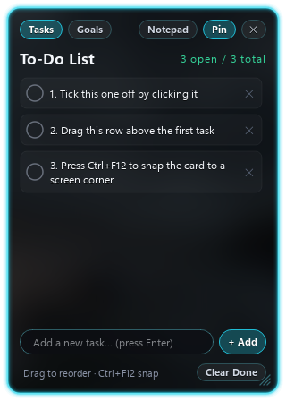
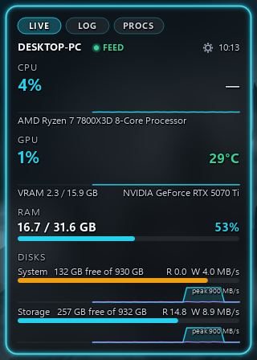
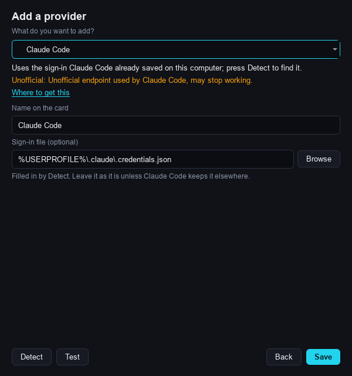

# Desktop Widgets

Three frosted-glass widgets bring your tasks, AI usage and computer stats to your Windows 10 or Windows 11 desktop, and to Linux (x86_64, tested on GNOME on Wayland). Choose the widgets you want and make them your own.

| To-Do Widget | Usage Monitor | Desktop Monitor |
|:---:|:---:|:---:|
|  |  |  |

## Meet the widgets

**To-Do Widget** keeps a plain-text task list close at hand. Tick tasks off, drag them to reorder, or use **Notepad** to edit the list directly. Press **Ctrl+F12** to snap the card to a screen corner. The **Goals** tab lets you add SMART goals and steps and track your progress.

**Usage Monitor** shows AI usage limits with progress bars and reset countdowns, as well as credits and budgets where available. Use the **ALL**, **FAVOURITES** and **CREDITS** tabs to switch views. It starts empty: add everything you want to track through its Settings window.

**Desktop Monitor** displays live CPU, GPU, RAM and disk metrics, with **LIVE**, **LOG** and **PROCS** tabs. It supports NVIDIA, AMD, Intel and integrated graphics. An optional CPU temperature sensor helper adds temperature readings when supported. In Settings you can customize the status indicator, drive visibility and background image.

## Download and install

1. Download **DesktopWidgets-Setup-1.0.0.exe** from the project's releases and run it.
2. If Windows SmartScreen shows **Windows protected your PC** and **Unknown publisher**, the installer is unsigned, so Windows cannot verify its publisher. If you trust the download, click **More info**, then **Run anyway**.
3. Tick any combination of **To-Do Widget**, **Usage Monitor** and **Desktop Monitor**. Under Desktop Monitor, you can also choose **CPU temperature sensor**.
4. Follow the remaining prompts and start your chosen widgets.

The normal installation does not need administrator rights. If you select **CPU temperature sensor**, Windows asks for administrator approval once. This installs the helper into `%ProgramFiles%\DesktopWidgets\CpuTempHelper`, registers the **DesktopWidgets CPU Temperature** scheduled task, and installs the PawnIO driver if it is not already present.

For an unattended installation, for example:

```text
DesktopWidgets-Setup-1.0.0.exe /VERYSILENT /COMPONENTS="todo,usage,monitor"
```

## Linux

Desktop Widgets runs on 64-bit (x86_64) Linux with glibc and a desktop session. It is tested on GNOME on Wayland with an NVIDIA GPU.

### Install

1. Download **DesktopWidgets-1.0.0-linux-x86_64.tar.gz** from the project's releases.
2. Extract it and open the new folder:

   ```text
   tar -xzf DesktopWidgets-1.0.0-linux-x86_64.tar.gz
   cd DesktopWidgets-1.0.0-linux-x86_64
   ```

3. Run the installer as your own user. Do not use `sudo`: the installer refuses to run as root and installs only for you.

   ```text
   ./install.sh
   ```

   The installer asks which widgets you want: any combination of **To-Do Widget**, **Usage Monitor** and **Desktop Monitor**. In a desktop session with `zenity` installed it shows a tick-box window; otherwise it asks plain `[Y/n]` questions. It then:

   - copies the program to `~/.local/share/DesktopWidgets`;
   - adds launchers named `desktopwidgets-todo`, `desktopwidgets-usage` and `desktopwidgets-desktop` in `~/.local/bin`;
   - adds menu entries called **Desktop Widgets: To-Do Widget**, **Desktop Widgets: Usage Monitor** and **Desktop Widgets: Desktop Monitor**.

4. Start your widgets from the application menu, or run `desktopwidgets-todo`, `desktopwidgets-usage` or `desktopwidgets-desktop`.

For an unattended installation, for example:

```text
./install.sh --components todo,usage,desktop --yes --autostart
```

| Option | What it does |
|---|---|
| `--components LIST` | Comma list of `todo`, `usage` and `desktop`. The default is all three. |
| `--yes` | No questions. Uses the defaults and your other options. |
| `--prefix DIR` | Install into another folder. The path must be absolute. The default is `~/.local/share/DesktopWidgets`. |
| `--autostart` | Also start the chosen widgets when you sign in. |
| `--help` | Show the options. |

Running `install.sh` again upgrades the existing install in place.

### Requirements

- A 64-bit (x86_64) Linux desktop with glibc at least as new as the system that built the package (the GitHub build uses Ubuntu, `ubuntu-latest`). Older distributions should build their own with `build.py --linux`.
- A Secret Service key store, such as **GNOME Keyring** or **KWallet**, to save API keys. Without one, Usage Monitor says so in Settings and refuses to save a key. On Ubuntu you can install GNOME Keyring yourself with:

  ```text
  sudo apt install gnome-keyring libsecret-1-0
  ```

- On GNOME, the **AppIndicator** extension if you want the tray icon. See the notes below.

### Uninstall

Run the uninstaller that the installer copied into the program folder:

```text
~/.local/share/DesktopWidgets/uninstall.sh
```

It stops any running widgets and removes the program files, launchers, menu entries and autostart entries. Your settings are kept unless you say otherwise:

- In a terminal it asks whether to also delete the data folders of the widgets you are removing (inside `~/.config/DesktopWidgets`). The default answer, `N`, keeps them. If you say yes, it also removes saved provider keys from the key store, and asks a separate `[y/N]` question before deleting the shared card background (`~/.config/DesktopWidgets/widget_background.json`).
- `--keep-data` keeps your settings, data and saved API keys. This is what happens when you run it without a terminal.
- `--purge-data` deletes the data folders of the removed widgets and removes the saved provider keys from the key store, without asking (the shared `widget_background.json` is kept unless confirmed in a terminal).

If you installed into another folder with `--prefix`, pass the same folder to `uninstall.sh --prefix DIR`.

### What is different on Linux

- **Window placement.** Wayland lets the desktop place windows, not the app. So corner snapping does nothing (the To-Do Widget's **Ctrl+F12** and its menu item are Windows only), remembered window positions do not work, and "always on bottom" is ignored. Dragging the To-Do card still works: the card asks the desktop to move it.
- **No frosted blur.** The blur effect used the Windows wallpaper, which Linux does not provide. The cards use flat dark glass, or your own background image from Settings, which all three widgets share.
- **Tray icon.** A tray icon needs a tray host. GNOME shows tray icons only with the AppIndicator extension. Without one the widgets still work: use the gear icon on a card, or right-click the card header, to open Settings and the menu. Usage Monitor and Desktop Monitor also accept `--settings`, which opens Settings straight away.
- **API keys.** Usage Monitor keeps API keys in the Secret Service, never in `config.json` or in a log. If no key store is running, Settings refuses to save a key.
- **Desktop Monitor readings.** CPU temperature comes from the kernel's sensors (coretemp, k10temp, zenpower and cpu_thermal are checked), so there is no helper and no administrator approval. The card shows a dash if no sensor is found. GPU readings come from NVIDIA's NVML library when the driver is present, otherwise from basic data in `/sys/class/drm`, otherwise the card shows "No GPU readings".
- **Fonts and icons.** Linux uses the desktop's default sans font. The gear and tick icons are drawn by the app, so they do not depend on a symbol font.

## Adding providers in Usage Monitor

Open Settings using the gear icon on the card, or right-click the system tray icon and choose **Settings...**. Select **Add a provider**, choose a type, fill in its details, and save it. You can return to Settings to edit, disable or remove providers.



- **Local sign-in: Claude Code, Codex and Antigravity.** Click **Detect** to find the existing local sign-in file under `%USERPROFILE%`, then click **Test** and **Save**. These providers use unofficial endpoints that may change or stop working.
- **API keys: NanoGPT, OpenRouter and DeepSeek.** Paste your API key, click **Test**, then **Save**. Keys are stored in Windows Credential Manager under the service `DesktopWidgets.UsageMonitor`; they are never stored in `config.json` or log files.
- **Google AI Studio via T3 Code.** This local database counter becomes available in the provider list when the T3 Code database is present on the PC. Add it in Settings. It counts requests made through T3 Code on this computer; it does not retrieve the service's remaining quota.
- **Custom JSON provider.** Choose **Custom (JSON endpoint)** and enter the service URL and request method. If needed, supply a key, header name and prefix. Enter dot-notation paths to the values in the response, such as `data.used`, `data.limit` and `data.balance`, and a unit such as `USD` or `credits`. Test the connection and save it.
- **Manual and Modal budgets.** For services without a direct key-based billing API, enter your monthly credit, optional cap, amount spent and reset day. Update the figures yourself as spending changes. The Modal option is a manual budget preset.

## Where your data lives

Type an environment-variable path into File Explorer's address bar to open it.

| Data | Location |
| --- | --- |
| To-Do Widget tasks, goals and settings | `%APPDATA%\DesktopWidgets\TodoWidget` |
| Usage Monitor provider settings and cache | `%APPDATA%\DesktopWidgets\UsageMonitor` |
| Desktop Monitor settings and data | `%APPDATA%\DesktopWidgets\DesktopMonitor` |
| Shared background setting | `%APPDATA%\DesktopWidgets\widget_background.json` |
| Saved Usage Monitor API keys | Windows Credential Manager, service `DesktopWidgets.UsageMonitor` |

On Linux the data is under `~/.config/DesktopWidgets` (or `$XDG_CONFIG_HOME/DesktopWidgets` if you set `XDG_CONFIG_HOME`):

| Data | Location on Linux |
| --- | --- |
| To-Do Widget tasks, goals and settings | `~/.config/DesktopWidgets/TodoWidget` |
| Usage Monitor provider settings and cache | `~/.config/DesktopWidgets/UsageMonitor` |
| Desktop Monitor settings and data | `~/.config/DesktopWidgets/DesktopMonitor` |
| Shared background setting | `~/.config/DesktopWidgets/widget_background.json` |
| Saved Usage Monitor API keys | Secret Service (GNOME Keyring or KWallet), service `DesktopWidgets.UsageMonitor` |
| Start when I sign in | `~/.config/autostart/desktopwidgets-<key>.desktop`, where `<key>` is `todo`, `usage` or `desktop` |

## Uninstalling

Open Windows **Installed apps** (or **Add or remove programs**), find Desktop Widgets and select **Uninstall**. You can also run `unins000.exe` from the installation folder.

Uninstall removes program files, Start Menu shortcuts and **Start with Windows** registry entries. If installed, it also removes the elevated CPU temperature scheduled task and helper. Your personal data in `%APPDATA%\DesktopWidgets` is kept by default. During interactive uninstall, you can confirm deletion of that data and the saved API keys in Windows Credential Manager.

## Building from source

Developers need 64-bit Python 3.12 or newer and Inno Setup 6. From the project folder, run:

```text
python build.py
```

The build creates `.build-venv`, runs the unit tests, downloads and verifies the LibreHardwareMonitor DLLs, freezes the applications with PyInstaller, and compiles `dist\DesktopWidgets-Setup-1.0.0.exe`.

To build the Linux package, run this on a Linux machine with Python 3.12 (or `uv`) from the project folder:

```text
python3.12 build.py --linux
```

It creates `.build-venv-linux`, runs the unit tests with the offscreen Qt platform, freezes the three widgets with PyInstaller, and writes `dist/DesktopWidgets-1.0.0-linux-x86_64.tar.gz`.

The build machine needs the X11 libraries that Qt's X11 support loads, so that they are copied into the package. The build stops with a message if they are missing. On Ubuntu:

```text
sudo apt install libxcb-cursor0 libxcb-icccm4 libxcb-image0 libxcb-keysyms1 libxcb-render-util0
```

## Licence

Desktop Widgets is available under the [MIT Licence](LICENSE). See [Third-party notices](THIRD_PARTY_NOTICES.md) for included components and their licences.
