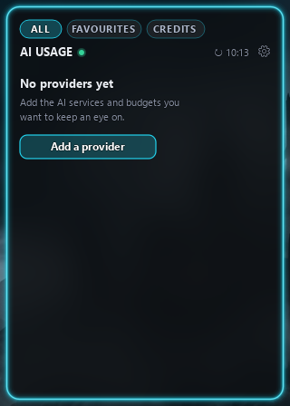

# Desktop Widgets

Three frosted-glass widgets bring your tasks, AI usage and computer stats to your Windows 10 or Windows 11 desktop. Choose the widgets you want and make them your own.

| To-Do Widget | Usage Monitor | Desktop Monitor |
|:---:|:---:|:---:|
|  |  |  |

## Meet the widgets

**To-Do Widget** keeps a plain-text task list close at hand. Tick tasks off, drag them to reorder, or use **Notepad** to edit the list directly. Press **Ctrl+F12** to snap the card to a screen corner. The **Goals** tab lets you add SMART goals and steps and track your progress.

**Usage Monitor** shows AI usage limits with progress bars and reset countdowns, as well as credits and budgets where available. Use the **ALL**, **FAVOURITES** and **CREDITS** tabs to switch views. It starts empty: add everything you want to track through its Settings window.

**Desktop Monitor** displays live CPU, GPU, RAM and disk metrics, with **LIVE**, **LOG** and **PROCS** tabs. It supports NVIDIA, AMD, Intel and integrated graphics. An optional CPU temperature sensor helper adds temperature readings when supported. In Settings you can customize the status indicator, drive visibility and background image.

## Download and install

1. Download **DesktopWidgets-Setup-1.0.0.exe** from the project's releases and run it.
2. If Windows SmartScreen shows **Windows protected your PC** and **Unknown publisher**, the installer is unsigned, so Windows cannot verify its publisher. If you trust the download, click **More info**, then **Run anyway**.
3. Tick any combination of **To-Do Widget**, **Usage Monitor** and **Desktop Monitor**. Under Desktop Monitor, you can also choose **CPU temperature sensor**.
4. Follow the remaining prompts and start your chosen widgets.

The normal installation does not need administrator rights. If you select **CPU temperature sensor**, Windows asks for administrator approval once. This installs the helper into `%ProgramFiles%\DesktopWidgets\CpuTempHelper`, registers the **DesktopWidgets CPU Temperature** scheduled task, and installs the PawnIO driver if it is not already present.

For an unattended installation, for example:

```text
DesktopWidgets-Setup-1.0.0.exe /VERYSILENT /COMPONENTS="todo,usage,monitor"
```

## Adding providers in Usage Monitor

Open Settings using the gear icon on the card, or right-click the system tray icon and choose **Settings...**. Select **Add a provider**, choose a type, fill in its details, and save it. You can return to Settings to edit, disable or remove providers.


- **Local sign-in: Claude Code, Codex and Antigravity.** Click **Detect** to find the existing local sign-in file under `%USERPROFILE%`, then click **Test** and **Save**. These providers use unofficial endpoints that may change or stop working.
- **API keys: NanoGPT, OpenRouter and DeepSeek.** Paste your API key, click **Test**, then **Save**. Keys are stored in Windows Credential Manager under the service `DesktopWidgets.UsageMonitor`; they are never stored in `config.json` or log files.
- **Google AI Studio via T3 Code.** This local database counter becomes available in the provider list when the T3 Code database is present on the PC. Add it in Settings. It counts requests made through T3 Code on this computer; it does not retrieve the service's remaining quota.
- **Custom JSON provider.** Choose **Custom (JSON endpoint)** and enter the service URL and request method. If needed, supply a key, header name and prefix. Enter dot-notation paths to the values in the response, such as `data.used`, `data.limit` and `data.balance`, and a unit such as `USD` or `credits`. Test the connection and save it.
- **Manual and Modal budgets.** For services without a direct key-based billing API, enter your monthly credit, optional cap, amount spent and reset day. Update the figures yourself as spending changes. The Modal option is a manual budget preset.

## Where your data lives

Type an environment-variable path into File Explorer's address bar to open it.

| Data | Location |
| --- | --- |
| To-Do Widget tasks, goals and settings | `%APPDATA%\DesktopWidgets\TodoWidget` |
| Usage Monitor provider settings and cache | `%APPDATA%\DesktopWidgets\UsageMonitor` |
| Desktop Monitor settings and data | `%APPDATA%\DesktopWidgets\DesktopMonitor` |
| Shared background setting | `%APPDATA%\DesktopWidgets\widget_background.json` |
| Saved Usage Monitor API keys | Windows Credential Manager, service `DesktopWidgets.UsageMonitor` |

## Uninstalling

Open Windows **Installed apps** (or **Add or remove programs**), find Desktop Widgets and select **Uninstall**. You can also run `unins000.exe` from the installation folder.

Uninstall removes program files, Start Menu shortcuts and **Start with Windows** registry entries. If installed, it also removes the elevated CPU temperature scheduled task and helper. Your personal data in `%APPDATA%\DesktopWidgets` is kept by default. During interactive uninstall, you can confirm deletion of that data and the saved API keys in Windows Credential Manager.

## Building from source

Developers need 64-bit Python 3.12 or newer and Inno Setup 6. From the project folder, run:

```text
python build.py
```

The build creates `.build-venv`, runs the unit tests, downloads and verifies the LibreHardwareMonitor DLLs, freezes the applications with PyInstaller, and compiles `dist\DesktopWidgets-Setup-1.0.0.exe`.

## Licence

Desktop Widgets is available under the [MIT Licence](LICENSE). See [Third-party notices](THIRD_PARTY_NOTICES.md) for included components and their licences.
